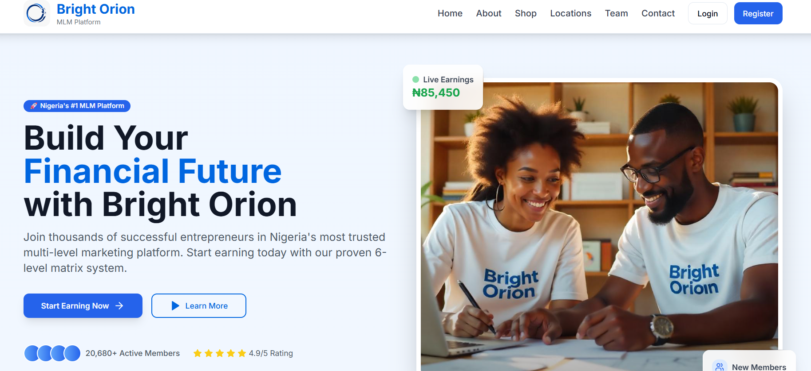
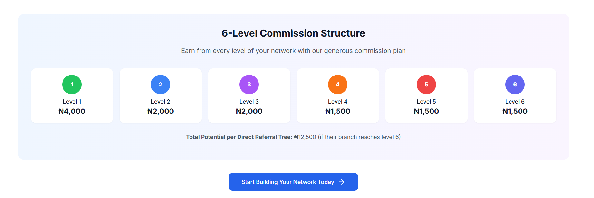
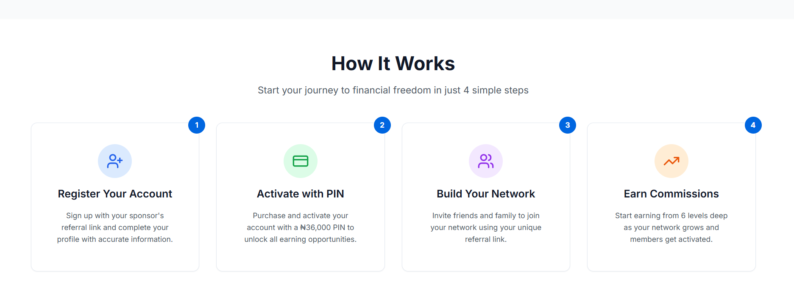
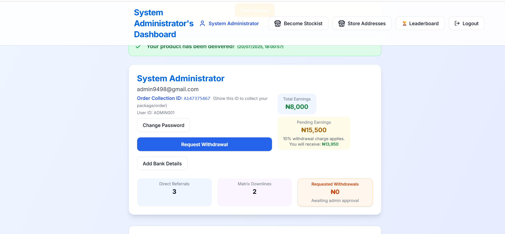
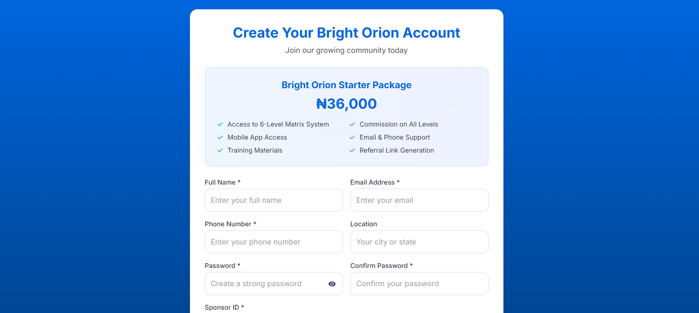
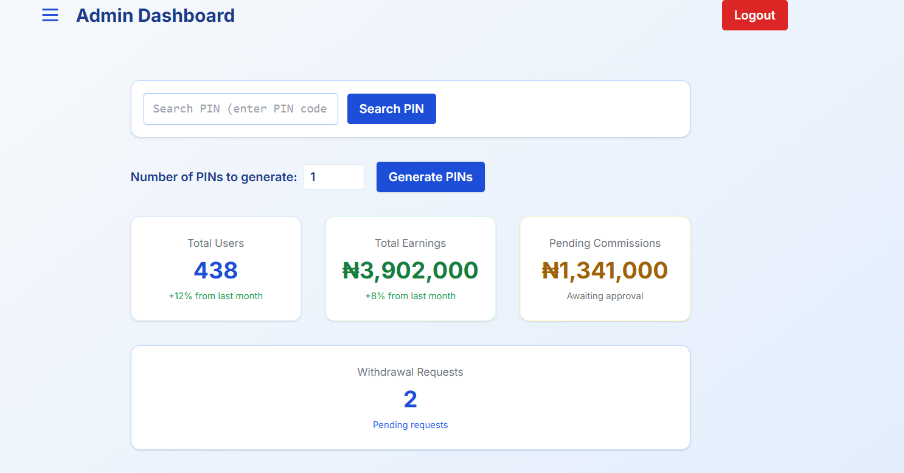

# Bright Orion MLM Platform

🚀 **Nigeria's Premier Multi-Level Marketing Platform**

Bright Orion is a high-performance, secure, and scalable Multi-Level Marketing (MLM) platform designed to empower entrepreneurs and organizations. Built with a modern tech stack centered around **Next.js** and **Firebase**, it provides a seamless experience for members and comprehensive control for administrators.

---

## 🌟 Visual Showcase

### 🖥️ Modern Experience
The platform features a stunning, fast, and responsive user interface designed to maximize engagement and conversion.


*Professional landing page with advanced animations and clear value propositions.*

### 📊 Earning Potential
Our specialized 6-level matrix commission system is visually explained to users, ensuring transparency and building trust.


*Detailed 6-level matrix visualization explaining the reward system.*

### 🛠️ Platform Mechanics
A clear "How It Works" section guides new users through the registration and activation process.


*Step-by-step guide for onboarding and growth.*

---

## 👥 User Experience

### 📱 Intuitive Member Dashboard
Members get a clear overview of their earnings, referrals, and account status with real-time data visualization.


*Comprehensive overview of member statistics and quick actions.*

### 🔑 Secure Registration
A streamlined registration process with integrated sponsor tracking and PIN-based activation.


*Responsive and secure registration flow.*

---

## 🛡️ Administrative Control

### 🛂 Advanced Admin Management
The powerful admin dashboard provides total oversight of the system, including user management, payment verification, and commission approvals.


*Full-featured command center for platform administrators.*

---

## ✨ Features

- 🔐 **Secure Authentication**: Robust login and registration system with Firebase Auth.
- 💳 **Payment Integration**: Seamless payment processing with Paystack (integrated with Firestore).
- 📊 **6-Level Matrix System**: Automated commission calculation and distribution.
- 👥 **Hierarchical Tracking**: Sophisticated sponsor and upline management.
- 📈 **Real-time Analytics**: Dynamic charts and reports using Recharts.
- 📱 **Responsive Design**: Fully optimized for mobile, tablet, and desktop viewing.
- 🔑 **PIN-based Activation**: Extra layer of security and controlled member onboarding.
- 📧 **Automated Notifications**: Transactional emails and system alerts via Nodemailer.
- 💰 **Withdrawal System**: Professional request and approval workflow for payouts.

---

## 🛠️ Tech Stack

### Frontend
- **Framework**: Next.js 14 (App Router)
- **Library**: React 18
- **Language**: TypeScript
- **Styling**: Tailwind CSS + shadcn/ui
- **Animations**: Framer Motion
- **Icons**: Lucide React

### Backend & Infrastructure
- **Base**: Firebase (Global Orion Project)
- **Database**: Firebase Firestore (NoSQL)
- **Authentication**: Firebase Auth
- **Admin SDK**: Firebase Admin
- **Deployment**: Vercel / Firebase Hosting
- **Serverless**: Next.js API Routes

### Integration & Security
- **Payments**: Paystack API
- **Emails**: Nodemailer / SMTP
- **Security**: JWT (Jose), Input Validation (Zod), Rate Limiting

---

## 🚀 Getting Started

### Prerequisites
- Node.js 18.x or higher
- A Firebase project ([Firebase Console](https://console.firebase.google.com/))
- A Paystack account (Test/Live keys)
- SMTP credentials (e.g., Gmail App Password)

### 1. Clone & Install
```bash
git clone https://github.com/alawantech/globalorion.git
cd globalorion
npm install
```

### 2. Environment Configuration
Create a `.env.local` file in the root directory and add the following:

```env
# Firebase Configuration
NEXT_PUBLIC_FIREBASE_API_KEY=your_api_key
NEXT_PUBLIC_FIREBASE_AUTH_DOMAIN=your_project.firebaseapp.com
NEXT_PUBLIC_FIREBASE_PROJECT_ID=your_project_id
NEXT_PUBLIC_FIREBASE_STORAGE_BUCKET=your_project.appspot.com
NEXT_PUBLIC_FIREBASE_MESSAGING_SENDER_ID=your_sender_id
NEXT_PUBLIC_FIREBASE_APP_ID=your_app_id
NEXT_PUBLIC_FIREBASE_MEASUREMENT_ID=your_measurement_id

# Firebase Service Account (JSON string)
FIREBASE_SERVICE_ACCOUNT_KEY={"type":"service_account",...}

# Admin Account (Initial Setup)
ADMIN_EMAIL="admin@example.com"
ADMIN_PASSWORD="secure_password"
ADMIN_PHONE="+234..."

# Paystack
PAYSTACK_SECRET_KEY="sk_test_..."
NEXT_PUBLIC_PAYSTACK_PUBLIC_KEY="pk_test_..."

# Email (SMTP)
SMTP_HOST="smtp.gmail.com"
SMTP_PORT="587"
SMTP_USER="your-email@gmail.com"
SMTP_PASS="your-app-password"
FROM_EMAIL="noreply@globalorion.com"
```

### 3. Run Development Server
```bash
npm run dev
```
Open [http://localhost:3000](http://localhost:3000) to see the result.

---

## 💰 Commission Structure

| Level | Reward (₦) | Type |
|-------|------------|------|
| **Level 1** | ₦4,000 | Direct Referral |
| **Level 2** | ₦2,000 | Indirect |
| **Level 3** | ₦2,000 | Indirect |
| **Level 4** | ₦1,500 | Indirect |
| **Level 5** | ₦1,500 | Indirect |
| **Level 6** | ₦1,500 | Indirect |

**Total Potential**: ₦12,500 per successful path completion.

---

## 📈 Version History

### 🔘 v1.1.0 (Current)
- Migrated backend from PostgreSQL (Neon) to **Firebase**.
- Enhanced real-time data synchronization.
- Optimized performance for mission-critical operations.
- Professional UI/UX refinements.

### 🔘 v1.0.0
- Initial release with core MLM functionality.

---

## 📞 Support & Credits

### Developed By
**Abubakar Lawan**
- 📧 [info@abubakardev.dev](mailto:info@abubakardev.dev)
- 📱 [+234 8100681294](tel:+2348100681294)
- 💻 [GitHub Profile](https://github.com/alawantech)

---

**Made with ❤️ in Nigeria 🇳🇬**
**© 2026 Global Orion Platform. All rights reserved.**